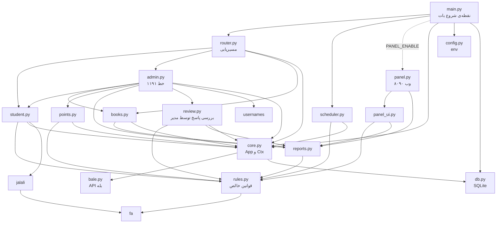
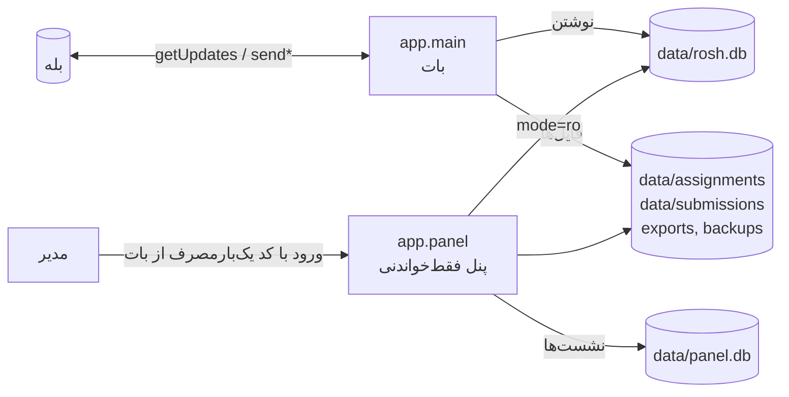

# نقشه‌ی پروژه — «چه چیزی کجاست؟»

> این فایل برای ویرایش و توسعه‌ی بی‌دردسر است. قبل از هر تغییر آن را بخوان؛ بعد از تغییر ساختاری به‌روزش کن
> (و `python scripts/map.py` را اجرا کن تا `docs/graph.json` با کد هم‌خوان بماند).
> تاریخ بررسی: ۱۴۰۵/۰۸/۰۹ (۳۱ اکتبر ۲۰۲۶) — روی کامیت `ec4c230` به‌علاوه‌ی تغییرهای نهم/تمرین بیشتر/تأخیر ۴ روزه.

## ۱. گراف وابستگی ماژول‌ها

پیکان «A ← B» یعنی A از B import می‌کند. لایه‌ی پایین‌تر هرگز لایه‌ی بالاتر را import نمی‌کند.

پایه‌ها (بدون وابستگی داخلی): `bale`, `config`, `db`, `fa`. `core` فقط به `bale` وابسته است (دیتابیس را از بیرون می‌گیرد).

## ۲. فرایندها و داده

- پنل ممکن است جدا (`python -m app.panel`) یا داخل فرایند بات (`PANEL_ENABLE=1`) اجرا شود.
- فقط **یک** نمونه‌ی بات (Replica=1)؛ دو نمونه یعنی پاسخ تکراری و رقابت روی SQLite.

## ۲-الف. پایه‌ها و مخاطب تکلیف

| ثابت (`app/rules.py`) | مقدار | معنی |
|---|---|---|
| `HOMEWORK_GRADES` | ۶، ۷، ۹ | تکلیف، مهلت، ارسال، بررسی، گزارش، پنل |
| `GAMIFIED_GRADES` | ۶ | نشان، امتیاز، شمارنده، صف تأیید (هفتم و نهم ندارند) |
| `GRADE_NAME` | ۶ ششم، ۷ هفتم، ۹ نهم | |
| `TARGET_ALL` | ۹۹ | تکلیف برای همه‌ی پایه‌های تکلیف |
| `TARGET_NAME` | | برچسب‌های مخاطب |

مخاطب تکلیف (`assignments.target_grade` وقتی `target_all=1`): ۶، ۷ یا ۹ = همان پایه؛ **۹۹ = همه‌ی پایه‌ها (پیش‌فرض تکلیف جدید)**؛ **۰ = ششم و هفتم** (معنی قدیمی «هر دو پایه»، تا تکالیف قبلی ناگهان برای نهمی‌ها ظاهر نشوند). تکلیف گروهی با `assignment_groups`. پایه‌ی نهم علاوه بر تکلیف، باشگاه کتابخوانی (`books.py`) دارد.

## ۳. هر فایل چه کاری می‌کند

| فایل | مسئولیت | نکته‌ی ویرایش |
|---|---|---|
| `app/main.py` | حلقه‌ی getUpdates، فراخوانی `scheduler.tick` هر ۶۰ ثانیه، راه‌اندازی پنل | خطای هر update گرفته می‌شود و پیام «مشکلی پیش آمد» می‌رود |
| `app/router.py` | تشخیص callback/پیام/گروه؛ `/start /menu /myid /whoami /setgroup` | `b:` فقط نهمی؛ پیام نهمی فقط در حالت `b:*` به `books` می‌رود |
| `app/core.py` | `App` (نگه‌دارنده‌ی cfg/bale/conn)، `Ctx`، حالت گفتگو، `send/show/send_file`، `audit`, `is_admin` | `get_setting/set_setting/admin_ids` پایین فایل به‌صورت monkey-patch به `App` چسبیده‌اند |
| `app/config.py` | همه‌ی متغیرهای محیطی (بخش ۶) | هر مقدار تازه: اینجا + `.env.example` |
| `app/db.py` | `SCHEMA` (۲۵ جدول) و `migrate()` | ستون تازه را هم در SCHEMA هم در `migrate` بگذار |
| `app/rules.py` | **تنها** جای منطق مهلت/تأخیر/نشان/امتیاز | هیچ import از لایه‌ی UI ندارد؛ آزمون‌پذیر |
| `app/student.py` | ورود، فهرست تکالیف، آپلود چندعکسه، ویرایش، بازخورد | `_extract` را `admin.py` هم import می‌کند |
| `app/admin.py` | تمام منوهای مدیر (۱۱۹۱ خط) | بزرگ‌ترین فایل؛ در بخش ۴ نقشه‌ی بخش‌هایش آمده |
| `app/review.py` | بررسی پاسخ توسط مدیر: وضعیت دستی، ناقص، بخشودن تأخیر (ADR 0005) | وضعیت را فقط با `rules.student_status` بخوان |
| `app/books.py` | باشگاه کتابخوانی پایه‌ی ۹ + بخش مدیر کتابخوانی + ثبت گروه | ارسال به گروه فقط با `book_group_chat_id` |
| `app/points.py` | صف تأیید امتیاز، تغییر دستی، حذف نشان | کاربر نهایی پایه‌ی ۹/۶ مستقیم امتیاز نمی‌گیرد |
| `app/reports.py` | اکسل، ZIP پاسخ‌ها (۴۰MB)، آمار و متن کتابخوانی | هم بات هم پنل از آن استفاده می‌کنند |
| `app/scheduler.py` | یادآوری، پشتیبان روزانه، پاک‌سازی exports | `reminders`, `daily_backup`, `cleanup_exports` |
| `app/panel.py` | سرور HTTP، ورود با کد، نشست، آستانه‌ی تلاش ناموفق | `open_ro` اتصال فقط‌خواندنی؛ هیچ نوشتنی در `rosh.db` نیست |
| `app/panel_ui.py` | HTML فارسی راست‌چین، ارقام فارسی، CSS/JS درون‌خطی | همه‌ی توابع فقط می‌خوانند |
| `app/bale.py` | `Bale` (httpx)، `btn`, `keyboard`, `BaleError` | |
| `app/fa.py` / `jalali.py` / `usernames.py` | ارقام فارسی، تاریخ جلالی، نرمال‌سازی یوزرنیم | تاریخ فقط با `jalali.fmt`، رقم فقط با `fa()` |
| `assets/` | فونت Vazirmatn، `logo.png` | پنل از اینجا سرو می‌کند |
| `deploy/` | Caddyfile نمونه، راهنمای همروش، install.sh، سرویس‌های systemd | |
| `scripts/map.py` | تولید `docs/graph.json` | جدول‌به‌ماژول و callback را نمی‌سازد (این فایل دستی است) |
| `tests/` | ۵ فایل آزمون (بخش ۷) | همه باید بعد از هر تغییر سبز باشند |

## ۴. دکمه‌ها (callback_data) و مسیر آن‌ها

قالب: `پیشوند:عمل:آرگومان…` با جداکننده‌ی `:`. مسیریابی در `router.route_callback`.

| پیشوند | کاربر | مقصد | یادداشت |
|---|---|---|---|
| `s:` | دانش‌آموز پایه‌ی ۶، ۷ و ۹ | `student.on_callback` | منوی نهمی علاوه بر تکالیف دکمه‌ی «📖 باشگاه کتابخوانی» (`b:home`) دارد |
| `b:` | فقط پایه‌ی ۹ | `books.on_callback` | بقیه‌ی پایه‌ها به منوی خودشان برمی‌گردند |
| `a:` | مدیر | `admin.on_callback` (و `books.admin_callback`، `points.*`، `review.callback`) | غیرمدیر: «مخصوص مدیران است» |

**`s:`** — a cancel code done ed fb fin home open prog rm rma send upload vw
**`b:`** — book cancel confirm d date dx from home mine new ok pb to
**`a:`** (94 عمل؛ گروه‌بندی بر اساس کار):
- تکلیف جدید: `new nb nk np nt ng ngd nbody ntitle npts ndl nconfirm npub ncancel` (مخاطب: `nt:all|g6|g7|g9|groups`؛ نوع: `nk:required|optional|bonus` — «optional» در رابط «تمرین بیشتر» نمایش داده می‌شود)
- فهرست/نمایش/ویرایش تکلیف: `alist aview aedit aedf aext aext1 aextv aext1s aext1v adel adely aexc aexcs ars arss arem azip asub as ast`
- بررسی پاسخ (ADR 0005): `arv rv rvl rvn rvs`
- دانش‌آموز: `slist st stg stgrp sttog stname stun uns sadd spts sbd sbdd sbddy sbde stzip strep streset codes lfail`
- گروه: `g glist gnew gadd gdel gdely gt`
- گزارش و اعلان: `rep rall rone rrecent rxlsx rbadges bc bct bcconfirm bcsend fb fbs`
- امتیاز/نشان: `pts pok pno pall padj badge bok bno bds`
- باشگاه کتابخوانی (مدیر): `book bke bkp`
- مدیران و پنل: `adm admadd admdel web menu`

> بسیاری از عمل‌های `a:` به «حالت گفتگو» (بخش ۵) وابسته‌اند، مثلاً `nk` فقط در حالت `a:nbody` کار می‌کند.

## ۵. حالت‌های گفتگو (جدول `chat_state`)

ثبت با `App.set_state(chat_id, state, data)`؛ `/start` و `/menu` همه را پاک می‌کنند (به‌همراه فایل‌های موقت). پیام متنی نهمی فقط وقتی به `books.on_message` می‌رود که حالتش با `b:` شروع شود؛ وگرنه به `student.on_message`.

| حالت | فایل | کار |
|---|---|---|
| `s:code` | student | انتظار کد ورود |
| `s:upload` | student | جمع‌کردن عکس/فایل پاسخ (پیش‌نویس `draft`) |
| `b:book` `b:from` `b:to` `b:date` `b:confirm` | books | مراحل ثبت گزارش مطالعه |
| `a:nbody` `a:npts` `a:ndl` `a:nconfirm` `a:ntitle` | admin | ساخت تکلیف |
| `a:aedit` `a:aextv` `a:aexc` `a:ars` | admin | ویرایش، تمدید، معافیت، بازارسال |
| `a:rvn` | review | یادداشت بررسی پاسخ |
| `a:sadd` `a:stname` `a:stun` `a:uns` `a:sbde` | admin/points | افزودن و ویرایش دانش‌آموز، نشان |
| `a:gnew` `a:bct` `a:bcconfirm` `a:fb` | admin | گروه، اعلان همگانی، بازخورد |
| `a:padj` `a:bds` `a:admadd` | admin/points | تغییر دستی امتیاز، نشان، افزودن مدیر |
| `a:bke` `a:bkp` | books | ویرایش گزارش کتاب (نام، صفحه‌ها) |

## ۶. تنظیمات محیطی

> مقدار واقعی روی سرور در `.env` است (هرگز در گیت یا این فایل نگذار). `.env.example` ریپو همان ساختار را بدون توکن و شناسه‌ی مدیر دارد. تفاوت شناخته‌شده با پیش‌فرض کد: `STREAK_SIZE=5` در `.env` سرور (پیش‌فرض کد ۶).

| متغیر | پیش‌فرض | توضیح |
|---|---|---|
| `BALE_TOKEN` | — (الزامی) | توکن بات |
| `ADMIN_IDS` | خالی | شناسه‌ی عددی مدیران ثابت (با `,` یا `،`) |
| `DATA_DIR` | `./data` (Docker: `/data`) | محل دیتابیس و فایل‌ها |
| `BALE_API_BASE` | `https://tapi.bale.ai` | |
| `GRACE_MINUTES` | ۲۰ | مهلت ارفاقی |
| `LATE_WINDOW_HOURS` | **۹۶ (۴ روز)** | پس از مهلت تا چند ساعت ارسال با تأخیر. روی هر تکلیف هنگام ساخت در `assignments.late_hours` ذخیره می‌شود؛ تکالیف قدیمی همان مقدار خودشان را نگه می‌دارند |
| `STREAK_SIZE` | ۶ | نشان پشتکار (تکالیف الزامی پشت‌سرهم) |
| `STREAK_POINTS` | ۰ | امتیاز نشان پشتکار |
| `EXTRA_STREAK_SIZE` / `EXTRA_STREAK_POINTS` | ۵ / ۱۰ | نشان کوشا (تمرین بیشتر/امتیازی) و امتیازش |
| `REMINDER_HOURS` | ۳ | |
| `MAX_FILE_MB` | ۱۵ | سقف هر فایل |
| `BOOK_MAX_PAGES` / `BOOK_MAX_DAYS_BACK` | ۳۰۰ / ۴۵ | محدودیت گزارش کتاب |
| `PANEL_ENABLE` / `PANEL_HOST` / `PANEL_PORT` / `PANEL_URL` | ۰ / `127.0.0.1` / ۸۰۹۰ / خالی | پنل |
| `PANEL_SECURE_COOKIE` / `PANEL_TRUST_PROXY` | ۰ / ۰ | پشت پروکسی HTTPS روشن شوند |
| `LOGIN_MODE` | `username` | `both` یعنی کد ۶ رقمی هم قبول است |
| `SQLITE_JOURNAL` | `WAL` | روی دیسک شبکه‌ای در صورت مشکل `DELETE` |

> `max_files_per_submission` (۱۵ فایل در هر ارسال) در `student.py` اعمال می‌شود ولی از env خوانده **نمی‌شود**.

## ۷. کدام جدول را کدام ماژول می‌خواند/می‌نویسد

(خودکار، بر اساس `FROM/INTO/UPDATE/JOIN`؛ 25 جدول)

| جدول | ماژول‌ها |
|---|---|
| `settings` | core scheduler |
| `admins` | admin core |
| `groups` | admin panel_ui reports |
| `students` | admin books core panel_ui points reports rules student |
| `student_groups` | admin reports rules |
| `assignments` | admin core panel_ui reports rules scheduler student |
| `assignment_groups` | admin panel_ui rules |
| `assignment_files` | admin panel_ui student |
| `student_deadlines` | admin rules |
| `excuses` | admin rules |
| `submissions` | admin panel_ui reports rules student |
| `submission_files` | admin panel_ui reports student |
| `resubmit_requests` | admin review rules |
| `feedback` | admin panel_ui reports student |
| `badges` | admin panel_ui points reports rules student |
| `reminders` | scheduler |
| `chat_state` | core |
| `book_reports` | books panel_ui reports |
| `points_ledger` | panel_ui points review rules |
| `badge_blocks` | points rules |
| `status_overrides` | review rules |
| `login_attempts` | admin student |
| `known_groups` | books |
| `web_logins` | admin panel |
| `audit` | core panel_ui |

نکته‌ها: تنها کلید استفاده‌شده در `settings` برابر `book_group_chat_id` است؛ `web_logins` کدها را HMAC‌شده نگه می‌دارد؛ `status_overrides` ویرایش مدیر روی وضعیت پاسخ است (ADR 0005)؛ `badges.status` و `points_ledger.status` صف تأیید مدیرند.

## ۸. آزمون‌ها و پوشش

| فایل آزمون | چه چیزی را می‌آزماید |
|---|---|
| `test_rules.py` | `rules` (مهلت، نشان، امتیاز) روی دیتابیس موقت |
| `test_flow.py` | جریان کامل مدیر⇄دانش‌آموز با `FakeBale` + `scheduler` + `reports` |
| `test_books.py` | باشگاه کتابخوانی، گزارش‌ها، ارسال به گروه |
| `test_login_edit.py` | ورود با یوزرنیم، ویرایش ارسال |
| `test_panel.py` | ورود پنل، فقط‌خواندنی بودن، صفحه‌ها |
| `test_review.py` | بررسی مدیر، نشان در انتظار تأیید (ADR 0005) |
| `test_grade7.py` | پایه‌ی هفتم بدون نشان و امتیاز؛ مخاطب‌یابی؛ مهاجرت تکالیف قدیمی |
| `test_grade9.py` | نهمی: منوی تکلیف + کتابخوانی، مخاطب «فقط نهم/همه»، بدون نشان و امتیاز، برچسب «تمرین بیشتر»، تأخیر ۴ روزه |

اجرا: `python tests/<نام>.py` (هر فایل مستقل است). وضعیت فعلی: ۸ از ۸ سبز.

### شکاف‌ها (به ترتیب ریسک)
1. هیچ آزمونی با بله‌ی **واقعی** نیست (`FakeBale`): دکمه‌ها، دریافت فایل، `from.username`، `/setgroup`.
2. `admin.py` (~۱۲۰۰ خط) فقط از طریق `test_flow/test_review/test_grade*` پوشش غیرمستقیم دارد؛ مسیرهای تمدید، معافیت و اعلان همگانی تک‌تک آزمون ندارند.
3. Docker image ساخته/اجرا نشده؛ `Dockerfile` و `deploy/*` آزمون ندارند.
4. `bale.py` و `jalali.py` آزمون واحد مستقل ندارند.
5. بار هم‌زمان پنل و بات روی یک SQLite (WAL) آزموده نشده.

## ۹. مشکلات و ابهام‌های پیداشده

1. `max_files_per_submission` در `student.py` اعمال می‌شود ولی از env قابل تغییر نیست.
2. `core.py`: `admin_ids/get_setting/set_setting` بعد از تعریف کلاس به `App` چسبانده شده‌اند؛ بهتر است داخل کلاس بروند.
3. `admin.py` بزرگ است؛ تقسیم به `admin_tasks / admin_students / admin_groups` توسعه را راحت‌تر می‌کند (با آزمون و بدون عجله).
4. `scripts/map.py` کامنت `# noqa: E402` را جزو نام import در `graph.json` ذخیره می‌کند (جزئی).
5. تکالیف ساخته‌شده پیش از تغییر، `late_hours=24` را نگه می‌دارند؛ فقط تکالیف جدید ۹۶ ساعت می‌گیرند.
6. در دیتابیس‌های قبلی، تکالیف با `target_grade=0` فقط برای ششم و هفتم می‌مانند (عمداً).

## ۱۰. قابلیت‌های فعلی (مرجع درست = همین کد)

**دانش‌آموز پایه‌ی ۶/۷/۹** (`student.py`): ورود با یوزرنیم بله، تکالیف باز، ارسال‌های من، ارسال چندعکسه/PDF با پیش‌نویس، ویرایش ارسال تا پایان بازه‌ی تأخیر (۴ روز)، پیشرفت، بازخوردها. فقط ششمی نشان و امتیاز دارد.
**پایه‌ی ۹ علاوه بر آن** (`books.py`): باشگاه کتابخوانی — دو روز، کتاب، از/تا صفحه، پیش‌نمایش، ثبت و ارسال خودکار به گروه بله، گزارش‌های من.
**مدیر** (`admin.py`, `review.py`, `points.py`, `books.py`): ساخت/ویرایش/لغو تکلیف (الزامی، **تمرین بیشتر**، امتیازی) برای همه‌ی پایه‌ها یا یک پایه یا گروه، تمدید مهلت، معافیت، ارسال مجدد، بررسی پاسخ و وضعیت دستی، دانش‌آموزان و گروه‌ها، اعلان همگانی، بازخورد، گزارش/اکسل/ZIP، تأیید نشان و امتیاز (ششم)، گزارش کتابخوانی، `/setgroup`.
**خودکار** (`scheduler.py`, `rules.py`): یادآوری، پشتیبان روزانه، پاک‌سازی exports، ارفاق ۲۰ دقیقه، ارسال با تأخیر تا ۹۶ ساعت (تکالیف جدید)، نشان پشتکار و کوشا با تأیید مدیر.
**پنل وب فقط‌خواندنی**: داشبورد، دانش‌آموزان، تکالیف، نشان‌ها، بازخورد، امتیاز، کتابخوانی، لاگ، اکسل؛ صفحه‌ی نهمی هم تکالیف و هم کتابخوانی را نشان می‌دهد.

> ارتباط با کارنامه و آزمون تستی هنوز در ریپو نیست (README آن را «فاز بعد» می‌نامد).

## ۱۱. فهرست توابع هر ماژول (خودکار از `docs/graph.json`)

> برای جست‌وجوی سریع «تابع کجاست». بعد از `python scripts/map.py` این بخش را بازسازی کن.

**`app/admin.py`** (1214 خط)

`menu`, `student_buttons`, `tell`, `notify_new_badges`, `open_btn`, `notify_assignment`, `target_text`, `group_rows_toggle`, `new_start`, `st_ntitle`, `st_nbody`, `new_kind`, `ask_points`, `st_npts`, `new_target`, `ask_deadline`, `st_ndl`, `publish`, `new_cancel`, `alist`, `tally`, `aview`, `astatus`, `aview_pick`, `asub_view`, `azip`, `aremind`, `ask_ext_all`, `st_aextv`, `st_aext1v`, `st_aedit`, `st_aexc`, `st_ars`, `slist`, `new_code`, `parse_student_line`, `st_sadd`, `codes`, `st_uns`, `st_stun`, `login_fails`, `sview`, `stgrp`, `stg_toggle`, `st_stname`, `streset`, `sttog`, `stzip`, `glist`, `st_gnew`, `gview`, `gmembers`, `gt_toggle`, `gdel`, `rep_menu`, `rep_xlsx`, `rep_recent`, `rep_badges`, `strep`, `ask_feedback`, `st_fb`, `bc_start`, `bc_recipients`, `st_bct`, `bc_send`, `st_bds`, `adm_view`, `st_admadd`, `web_login`, `on_message`, `_pending`, `on_callback`

**`app/bale.py`** (120 خط) — کلاس‌ها: BaleError, Bale

`btn`, `keyboard`

**`app/books.py`** (414 خط)

`md_safe`, `pair_label`, `report_text`, `recent_pairs`, `_int`, `prev_books`, `has_report`, `group_id`, `post_report`, `record_group`, `start`, `_choose_pair`, `_ask_from`, `_preview`, `on_callback`, `on_message`, `home`, `finish`, `mine`, `a_menu`, `a_group_pick`, `set_group`, `_report_line`, `a_list`, `a_view`, `st_edit_book`, `st_edit_pages`, `admin_callback`

**`app/config.py`** (84 خط) — کلاس‌ها: Config

`load_env`, `_int`, `load`

**`app/core.py`** (159 خط) — کلاس‌ها: Ctx, App

`_admin_ids`, `_get_setting`, `_set_setting`

**`app/db.py`** (167 خط)

`connect`, `_cols`, `migrate`

**`app/fa.py`** (38 خط)

`fa`, `en`, `clean`, `duration`

**`app/jalali.py`** (137 خط)

`g2j`, `j2g`, `to_dt`, `jdate`, `weekday_name`, `fmt`, `fmt_short`, `from_jalali`, `parse`, `noon`, `parse_date`

**`app/main.py`** (79 خط)

`needs_pause`, `start_panel`, `run`

**`app/panel.py`** (427 خط) — کلاس‌ها: Store, PanelServer, Handler

`open_ro`, `code_hash`, `make_server`, `run`

**`app/panel_ui.py`** (506 خط)

`esc`, `has_logo`, `_fa_node`, `persian_digits`, `layout`, `login_page`, `chip`, `stat_bar`, `progress`, `table`, `link`, `students_active`, `groups_of`, `tally`, `files_html`, `dashboard`, `_uname`, `students_page`, `student_page`, `assignments_page`, `assignment_page`, `badges_page`, `feedback_page`, `audit_page`, `not_found`, `_pair`, `_book_section`, `student_book_page`, `books_page`, `points_page`

**`app/points.py`** (209 خط)

`tell`, `pending_count`, `_pending_items`, `pending_view`, `_decide`, `approve`, `reject`, `approve_badge`, `reject_badge`, `approve_all`, `student_points`, `st_padj`, `badges_view`, `badge_delete`, `st_sbde`

**`app/reports.py`** (321 خط)

`safe_name`, `cell_text`, `_cell_base`, `group_names`, `class_lines`, `student_report`, `build_xlsx`, `_final_files`, `build_zips`, `week_start`, `_norm_book`, `book_stats`, `book_summary_text`, `student_book_report`, `_xl_style`, `build_books_xlsx`, `_pair`

**`app/review.py`** (167 خط)

`_tell`, `_status_text`, `student_list`, `pick_student`, `view`, `apply`, `_sync_bonus_points`, `_notify_student`, `st_note`, `callback`

**`app/router.py`** (125 خط)

`handle`, `_display`, `route_group`, `route_callback`, `route_message`

**`app/rules.py`** (350 خط)

`gamified`, `is_target`, `_closed_before_join`, `targets_for_student`, `target_students`, `effective_deadline`, `verdict`, `current_final`, `open_resubmit`, `is_excused`, `get_override`, `student_status`, `can_submit`, `finalize`, `streak_state`, `extra_streak_state`, `add_points`, `points_total`, `student_stats`, `give_badge`, `badge_is_pending`, `_withdraw_pending`, `award_auto`, `describe_for_student`

**`app/scheduler.py`** (88 خط)

`tick`, `reminders`, `cleanup_exports`, `daily_backup`

**`app/student.py`** (506 خط)

`menu_rows`, `notify_admins`, `learn_username`, `try_login`, `start_login`, `ask_code`, `on_code`, `home`, `list_open`, `list_done`, `progress`, `feedbacks`, `view_assignment`, `view_mine`, `start_edit`, `show_draft`, `remove_file`, `_purge_superseded`, `start_upload`, `_unlink_if_unreferenced`, `_discard_drafts`, `_extract`, `on_upload_message`, `finish`, `cancel`, `on_callback`, `on_message`

**`app/usernames.py`** (16 خط)

`normalize`
